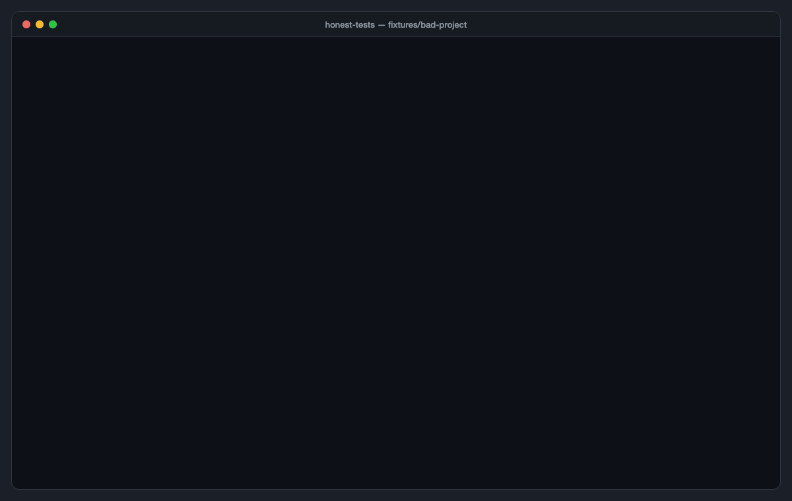

# honest-tests v0.1.0

**Your AI wrote 200 tests. Many can't fail.**

honest-tests is an agent skill plus a CLI for JS/TS test suites. It finds tests that can't fail, and
then proves which tests are weak by mutating your code and watching the suite stay green. It works
with Claude Code, Codex, Cursor or no agent at all.



```bash
npx honest-tests audit .                 # find tests that can't fail
npx honest-tests mutate src/pricing.ts   # break the code on purpose, see which tests notice
```

## Highlights

- **13 rules for fake and weak tests.** The rules catch things like `expect(x).toBe(x)`, tests with
  no assertions, asserting on a mock's configured return value, mocking the module under test,
  `try/catch` blocks that swallow the `AssertionError`, assertions that only run inside a `catch`,
  un-awaited `.resolves`, `toBeTruthy` without the `()`, and leftover `.only` and `.skip`.
- **New: `asserts-on-own-literal`.** This rule catches
  `const p = { service: 's3' }; expect(p.service).toBe('s3')`. Nothing from the code under test is
  involved, so the test can never fail. The pattern is common in runtime "type tests", because
  TypeScript types don't exist at runtime. The rule only fires when the asserted value traces back
  purely to literals declared in the same test, and that binding is never passed to a function,
  mutated or reassigned.
- **Built-in mutation testing.** `mutate` flips operators, booleans, constants, conditions and return
  values. It runs only the tests that reach the file, and lists every change nobody noticed. It works
  on a temporary copy of the project, so the working tree is never touched, even on Ctrl-C.
- **Agent-native.**
  - An Agent Skill teaches the rule *a test is honest only if it fails when the behavior it names is
    broken*. It covers a writing workflow (self-audit before saying "done") and a phased audit
    workflow (detect, verify, report, fix).
  - A Claude Code plugin adds `/honest-tests:audit` and `/honest-tests:mutate`.
  - `honest-tests init codex|cursor` writes an `AGENTS.md` section or a Cursor rule.
- **Fits into CI.** It provides `--json` output (schema v1), `--fail-on`, `--min-score` and
  suppression comments that take a reason.

## What it found in the wild

- **Open-source projects:** across 5 popular OSS JS/TS projects (11,178 tests, all 13
  current rules), 2.6% of tests got an error-level finding, and 0.6% had a high-confidence can't-fail
  bug (`never-failing-assertion`, `catch-only-assertion`, `tautological-assertion`,
  `asserts-on-mock` or `asserts-on-own-literal`).
- **100% line coverage:** in one app that enforces 100% line coverage, mutation testing still found
  that 15% of the changes to a formatting module are caught by no test.
- **Precision of the new rule:** `asserts-on-own-literal` was field-checked on 13 OSS JS/TS projects
  (about 27,000 tests). It made 14 hits, and a manual review found every one was an assertion that
  can't fail. There were no false positives. A prototype pass also found 15 hits in one real app.

## Install

```bash
npx honest-tests audit .                          # CLI, Node 22+
npx honest-tests init claude                      # skill into .claude/skills/
```

```text
/plugin marketplace add mintwork/honest-tests
/plugin install honest-tests@honest-tests
```

## Known limitations

- JS/TS only (vitest, jest, node:assert, chai). The pytest adapter is next.
- When `mutate` picks related tests, it doesn't follow path-alias imports (`@/lib/x`). Pass
  `--test-cmd` in that case.
- Mutants run one at a time. The bundled fixture takes about 12 s for 26 mutants.

Full changelog: [CHANGELOG.md](../CHANGELOG.md)
